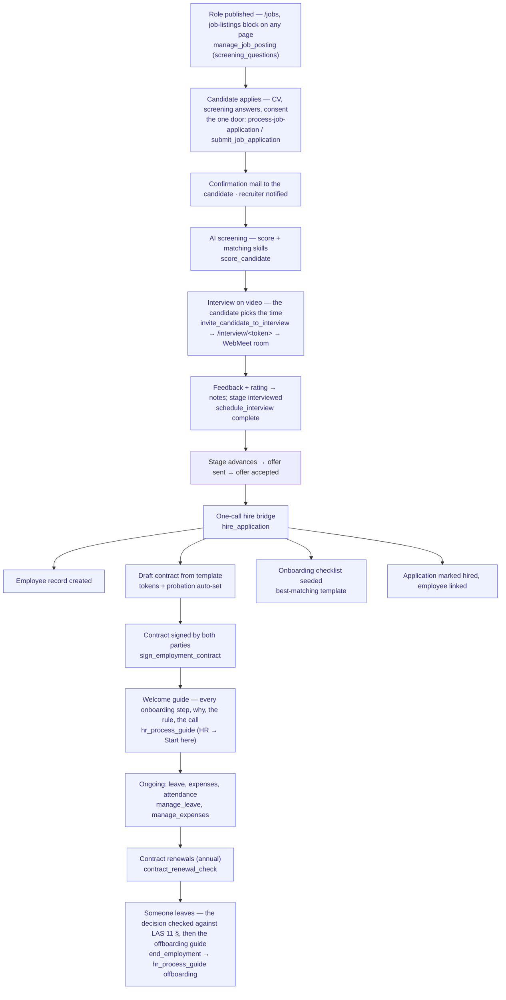

# Hire-to-Retire

> The full employee lifecycle — from hire to offboarding.

**Problem it solves:** A new hire means re-typing the same person into five places — contract, checklist, HR record, all by hand — this process turns an accepted offer into employee record, draft contract and onboarding checklist in one call, and keeps leave and expenses tidy afterwards.

**Maturity level:** L3 — Operational (auto-hire bridge live; payroll internal cycle live; performance still manual)
**Status:** ✅ Hire-to-Onboard automated; ✅ payroll runs live (`create_payroll_run`→`approve_payroll_run`→`mark_payroll_paid`, `generate_agi_export`, `year_end_payroll_summary`); ⚠️ statutory filing (AGI/Skatteverket submit) still external; ⚠️ lacks performance management

---

**AI assists, a person selects.** Applications are handled on the business's
own instance; AI parses, scores and drafts, and an agent's stage move or hire
waits for a person's approval (`move_application_stage`, `hire_application`,
`hire_candidate` are `approve`, pinned for FlowPilot in every posture). With a
local System AI the CV is parsed without leaving the instance — except a PDF,
which falls back to a cloud vision provider when one has a key; see
[Recruitment](../modules/recruitment-guide.md#the-promise-ai-assists-a-person-selects).

**A founder is led, not left with fourteen tabs.** After the hire, HR → *Start
here* walks the new employee's steps in order — contract within 7 days (LAS 6 c §),
pay details for AGI, vacation, the introduction, the probation decision, the first
salary — and, when someone leaves, the notice LAS 11 § allows, vacation pay, handover,
access and the final salary — each judged from the records with why it matters and the
rule behind it.
The rules are data per country — a FlowWink template (SE, NO, DK, FI, DE) or the
company's own terms (`manage_hr_rules`), never code. FlowPilot and agents over MCP
read the same guide (`hr_process_guide`); see [HR guide](../modules/hr-guide.md).

---

## Modules involved

| Module | Role in the process |
|--------|---------------------|
| **Recruitment** | Job postings, applications, AI scoring, hire bridge (`hire_application`) |
| **HR** | Employee records, leave handling, onboarding checklists, vacation auto-allocation |
| **Contracts** | Employment agreements, lifecycle, renewal checks |
| **Documents** | HR documents (contracts, certificates, policies) |
| **Expenses** | Employee expense claims (full P2P loop: submit → approve → book → pay) |
| **Resume** | Consultant profiles / talent matching |

---

## Step-by-step flow

*🟦 = agent-runnable step (see Agent coverage below)*

---

## Agent coverage

| Step | 👤 Manual | 🤖 FlowPilot | 🔗 External agent |
|------|----------|-------------|-------------------|
| Publish a role with screening questions | ✅ (Recruitment → job → Screening questions) | ✅ (`manage_job_posting` `screening_questions`) | ✅ MCP-exposed |
| Receive an application (consent, answers, CV, confirmation mail) | ✅ (`/jobs/<slug>`, job-listings block, FormBlock with a CV field) | ✅ (`submit_job_application`) | ✅ MCP-exposed |
| Candidate screening | ✅ | ✅ (`score_candidate`) | — |
| Notes and ratings on a candidate | ✅ (candidate card → Notes) | ✅ (`manage_candidate_note`) | ✅ MCP-exposed |
| Interview on video, the candidate picks the time | ✅ (candidate card → Interviews → Let them pick / Book) | ✅ (`invite_candidate_to_interview`, `schedule_interview`, `send_interview_confirmation`) | ✅ MCP-exposed |
| **Hire bridge (app→emp+contract+onboarding)** | ✅ | ✅ (`hire_application`) | ✅ MCP-exposed |
| **Welcome guide — what is left for a new hire, why, the rule** | ✅ (HR → Start here) | ✅ (`hr_process_guide`) | ✅ MCP-exposed |
| Employee registration | ✅ | ✅ (`manage_employee`) | ✅ MCP-exposed |
| Employment contract for someone added directly | ✅ (HR → Contracts) | ✅ (`manage_employment_contract`, `sign_employment_contract`) | ✅ MCP-exposed |
| **Someone leaves — who, the last day, the notice the law allows** | ✅ (HR → Start here → End an employment) | ✅ (`end_employment`, approve) | ✅ MCP-exposed |
| Offboarding steps (notice in writing, vacation left, handover, access, final salary, certificate) | ✅ (HR → Start here) | ✅ (`hr_process_guide` offboarding; access removal stays a person's) | ✅ MCP-exposed |
| One person's vacation days | ✅ (HR → Allocations, or the guide's *Allocate*) | ✅ (`manage_leave_allocation`) | ✅ MCP-exposed |
| Onboarding checklist | ✅ | ✅ (`onboarding_checklist`) | — |
| Leave requests | ✅ | ✅ (`manage_leave`) | — |
| **Year-end vacation allocation** | ✅ | ✅ (`auto_allocate_vacation`) | ✅ MCP-exposed |
| Contract renewal check | — | ✅ (`contract_renewal_check`) | — |
| Goals, 1:1s and performance reviews | ✅ (HR → Performance) | ✅ (`manage_performance`: create_goal / update_goal / schedule_one_on_one / complete_one_on_one / start_review / submit_review / acknowledge_review) | — |
| Org chart / reporting structure | ✅ (manager on the employee) | ✅ (`org_chart`, `manage_employee` `manager_id`) | — |
| Salary revision round and salary history | ✅ (HR → Compensation) | ✅ (`manage_compensation_revision`: create / propose / exclude / summary / approve / apply / apply_due / history) | — |
| Payroll runs | ✅ | ✅ (`create_payroll_run` → `approve_payroll_run` → `mark_payroll_paid`; `calc_sick_pay`, `apply_pension`, `list_payroll_lines`) | ✅ (admin functions, service-role verified) |

---

## Known gaps (missing for L3+)

- ✅ **Payroll runs** — the `payroll` module runs the internal cycle
  (create → approve → mark paid, with sick-pay calculation and pension
  application per line). What is still missing is the **statutory tail**:
  AGI/employer declarations to Skatteverket, payslip distribution, and
  export/integration to Fortnox Lön / Visma / Hogia for firms that file there
- ✅ Performance management (2026-10-06): goals, 1:1 notes and reviews through `manage_performance`, the org chart
  through `org_chart` — the same tables HR → Performance shows; proven in the battery (goal → 1:1 → probation review
  → acknowledged). Found on the way: the 1:1 policy compared an employee row with itself, so managers saw none of
  their 1:1s without the admin role — fixed.
- ✅ Compensation planning (2026-10-06): a budgeted revision round through `manage_compensation_revision` — lines
  pre-filled from each review's `salary_adjustment_pct` (or the round's default), approval refused over budget,
  application on the effective date writes the salary, the salary history row and the signed contract in one pass;
  an automation applies approved rounds on their date. Every salary change outside a round is logged too
  (`employee_salary_history`, hire / manual / revision). Proven in the battery (review +3 % → 43 260 kr → payroll).
- ✅ Time-off accrual: `auto_allocate_vacation` matches `vacation_policies` (age/tenure) + capped carry-over, audit-logged per employee
- ❌ Employment contract templates with Swedish collective agreements

---

## The test book — a person walks it

The battery proves the skills (what an agent does); this list is what a
**person** clicks, in the admin and as a candidate on the public site. Walk it
on the sandbox after a change to this process and write the date and who in the
last line. A step that fails is the finding — fix the product, not the list.

**The candidate (public site, private window, no account)**
- [ ] `/jobs` lists the published roles in the site's language; department and location filters appear when there is more than one.
- [ ] A page with the **Job Listings** block shows the same roles; a role opens `/jobs/<slug>`.
- [ ] The role page shows responsibilities, requirements and what we offer; *Apply now* jumps to the form.
- [ ] Apply with a PDF CV, answer the screening questions, tick consent (the text names the company and the retention months) → *Application received*.
- [ ] The confirmation mail arrives, in the candidate's language, from the company's name.
- [ ] Applying again with the same e-mail does not create a second card.
- [ ] Without ticking consent, or skipping a required question, the form says what is missing and sends nothing.

**The recruiter (admin, a user with the recruitment module — not only an admin)**
- [ ] The new application is in the bell / cockpit "acted on its own", and opens the candidate from its link.
- [ ] Recruitment → Pipeline: filter by role; the card shows the flagged-answer marker and days in stage; drag it to Screened.
- [ ] The candidate card: *Open CV* opens the uploaded file; the screening answers show, a flagged one marked; consent with the delete-by date.
- [ ] Add a note with a rating; it appears with the time.
- [ ] Interviews → *Let them pick*: propose three times → the candidate gets the mail.
- [ ] As the candidate: open the link, pick a time → *Your interview is booked*, *Join the interview*, *Add to calendar* (.ics); the confirmation mail arrives.
- [ ] Back in the admin: the interview is listed with *Join*; the card moved to Interview scheduled; the event is on the calendar.
- [ ] At the time: *Join* → WebMeet; the candidate waits in the waiting room until let in.
- [ ] *Done — feedback* with a rating → the card moves to Interviewed, the feedback is in the notes.
- [ ] Reject another candidate with a reason → the timeline shows it.
- [ ] Offer → accepted → *Hire candidate* → the employee, the draft contract and the onboarding checklist exist.

**The founder (HR → Start here)**
- [ ] The page opens on *Start here*: both guides, the people in each, *Employment rules* (the template for the business country), the map of tabs.
- [ ] A new hire's steps: the contract due day one + 7, *Why this matters* shows the rule; *Allocate* and the introduction checklist are one click; ticking items moves the progress.
- [ ] *End an employment* for someone with three years, redundancy: a last day one month out is refused in plain words; empty gives the earliest day (two months); *Record it* opens their offboarding steps.
- [ ] Offboarding: tick the written notice and the handover items; vacation with nothing recorded is a step to do; access removal has no agent button.
- [ ] *Employment rules → Adjust*: a longer notice saves as your own terms; *Back to template* restores it.

The battery walks the same guides as an agent (`theGuides`: each step's own fix call, the notice refused and accepted, the decision waiting for a person, own terms binding and reset).

Last walked: 2026-10-31, the founder part, in a browser on a fresh local stack (Claude) — fixes in `20261031170000`; the rest not yet.

---

## Webhook events

`employee.created`, `leave.requested`, `leave.status_changed`, `contract.created`, `contract.signed`, `contract.status_changed`, `expense.submitted`

---

## Best for

Smaller consultancies (< 30 employees) wanting simple HR data + document archive in one place.

## Not for

Companies that need a full HRIS with payroll, performance management, or collective-agreement logic. Pair with Fortnox/Visma for payroll.
